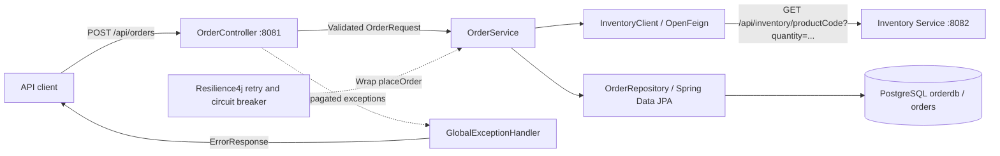
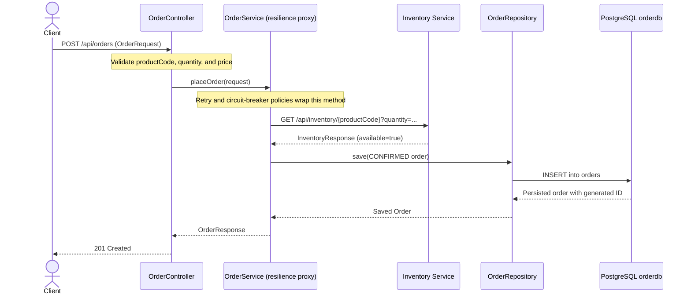

# Order Service

This is an independent Spring Boot Maven project. Open this directory by itself in IntelliJ IDEA or STS. It has its own `orderdb` database and never connects to `inventorydb`.

## Architecture

The service uses Java 17, Spring Boot, Spring MVC, Bean Validation, Spring Data
JPA, OpenFeign, and Resilience4j. Inventory is accessed synchronously over HTTP;
orders are stored in PostgreSQL.



| Component | Responsibility |
| --- | --- |
| `OrderServiceApplication` | Starts Spring Boot and enables Feign clients. |
| `OrderController` | Accepts order requests, validates their fields, and returns HTTP 201 on success. |
| `OrderService` | Checks stock, creates a `CONFIRMED` order, saves it, and maps it to `OrderResponse`. |
| `InventoryClient` | Calls the inventory endpoint using `inventory.service.url`. |
| `OrderRepository` and `Order` | Persist order ID, product code, quantity, price, status, and creation time in the `orders` table. |
| `GlobalExceptionHandler` | Maps supported exceptions to HTTP error responses. |
| `ResilienceLoggingConfig` | Registers listeners for retry outcomes, rejected calls, and circuit-breaker transitions. |
| `application.properties` | Configures the server, database, Hibernate, inventory URL, and resilience policies. |

## Order execution flow



1. Spring validates that `productCode` is nonblank and that `quantity` and `price`
   are nonnull and positive. A field-validation failure returns HTTP 400 before
   the service is called.
2. The controller invokes `OrderService.placeOrder` through the Spring proxy.
   When the circuit allows execution, the service asks Inventory Service whether
   the requested quantity is available.
3. An inventory HTTP 404 becomes `InsufficientStockException`. An inventory
   response with `available=false` raises the same exception. Other Feign failures
   become `InventoryServiceUnavailableException`.
4. When stock is available, the service creates an order using the submitted
   product code, quantity, and price, sets status to `CONFIRMED`, and records
   `LocalDateTime.now()` as its creation time.
5. JPA saves the order and assigns its database-generated ID. The service returns
   `orderId`, `productCode`, `quantity`, `price`, `status`, and `createdAt` in the
   response body.

The inventory request only checks availability; this implementation does not
reserve or deduct stock. It stores the submitted price without calculating an
order total. The resilience annotations cover the entire `placeOrder` method,
including persistence, so retrying that method repeats its execution.

### Failure and fallback flow

When the circuit rejects a call, the method body is skipped. The configured
`inventoryFallback(request, throwable)` preserves an existing
`InventoryServiceUnavailableException` and wraps any other failure in that
exception. Retryable failures can trigger another attempt; an exception that
ultimately escapes the service is handled by `GlobalExceptionHandler`.

| Exception reaching the handler | HTTP status | Error code |
| --- | --- | --- |
| `MethodArgumentNotValidException` or `ConstraintViolationException` | 400 | `VALIDATION_ERROR` |
| `InsufficientStockException` | 409 | `INSUFFICIENT_STOCK` |
| `InventoryServiceUnavailableException` or `FeignException` | 503 | `SERVICE_UNAVAILABLE` |

Error bodies contain `timestamp`, `status`, `error`, `message`, and `path`.
Request-body validation uses the first field error as its message.

The current fallback accepts `Throwable` and does not explicitly preserve
`InsufficientStockException`. If that exception reaches the fallback, it is
converted to an availability failure and can be retried and returned as HTTP 503
instead of HTTP 409. The configured ignore lists alone should not be read as a
guarantee that the fallback preserves business exceptions. This flow is based on
source inspection; the fallback interaction has not been verified in a live run.

## Run

Create the database with `CREATE DATABASE orderdb;`, ensure PostgreSQL accepts the
credentials in `src/main/resources/application.properties` (currently
`postgres`/`root` for local development), then run:

```text
mvn spring-boot:run
```

The service listens on port 8081 and calls `http://localhost:8082` through its OpenFeign client.

## API

```http
POST http://localhost:8081/api/orders
Content-Type: application/json

{"productCode":"P1001","quantity":2,"price":75000}
```

The order is saved only when Inventory Service reports sufficient stock.

## Resilience4j retry and circuit breaker

The `OrderService.placeOrder` method is protected by a Resilience4j retry and
circuit breaker named `inventory-service`.

- A failed inventory-service call is attempted up to 3 times in total (the initial
  call plus 2 retries).
- Retries use a fixed 10-second delay; exponential backoff is disabled.
- Only `InventoryServiceUnavailableException` triggers retries and counts as a
  circuit-breaker failure.
- The policies exclude `InsufficientStockException` from retries and
  circuit-breaker recording. See the fallback caveat above for failures that are
  converted to `InventoryServiceUnavailableException`.
- The circuit breaker evaluates the last 10 calls after at least 5 calls have
  completed. It opens when at least 50% have failed.
- An open circuit waits 10 seconds before allowing one test call in the
  `HALF_OPEN` state. A successful test call closes the circuit; a failed one
  opens it again.
- If all attempts fail, the API returns `503 Service Unavailable` and does not
  save an order.

The settings are in `src/main/resources/application.properties`. Runtime logs
show every inventory check, scheduled retry, retry result, rejected call,
fallback, and circuit-breaker state transition.

## Test retry behavior

1. Start PostgreSQL and Order Service, but leave Inventory Service stopped:

   ```text
   mvn spring-boot:run
   ```

2. From another terminal, submit an order:

   ```powershell
   curl.exe -i -X POST http://localhost:8081/api/orders `
     -H "Content-Type: application/json" `
     -d '{"productCode":"P1001","quantity":2,"price":75000}'
   ```

3. Watch the Order Service console. The logs should include entries similar to:

   ```text
   Checking inventory for productCode=P1001 quantity=2
   Retrying inventory-service: attempt=1 wait=10000ms cause=...
   Retrying inventory-service: attempt=2 wait=10000ms cause=...
   Retry inventory-service exhausted after 2 retry attempt(s): ...
   ```

   The retry waits contribute about 20 seconds before returning `503`, because
   there are two 10-second waits between the three attempts. HTTP connection and
   response time, and the current circuit state, also affect the observed duration.

## Test circuit-breaker and recovery behavior

1. Keep Inventory Service stopped and repeat the order request until the failure
   threshold is reached. Look for this state transition:

   ```text
   Circuit breaker inventory-service changed state from CLOSED to OPEN
   ```

2. Calls made while the breaker is open produce a rejection log:

   ```text
   Circuit breaker inventory-service rejected the inventory call because it is OPEN
   ```

3. Start Inventory Service on port `8082`, wait at least 10 seconds, and send the
   request again. The permitted test call should succeed, and the logs should show
   transitions through `HALF_OPEN` back to `CLOSED`. The order response should be
   `201 Created` when stock is available.

To compile the project and run any available automated tests (this repository
currently contains no test sources):

```text
mvn test
```
