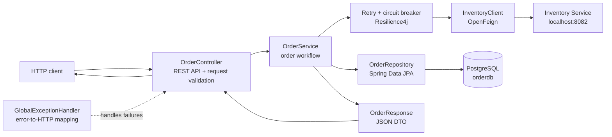
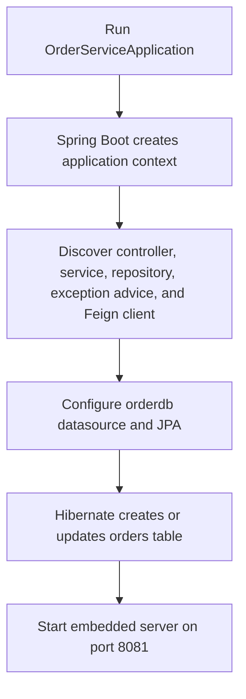
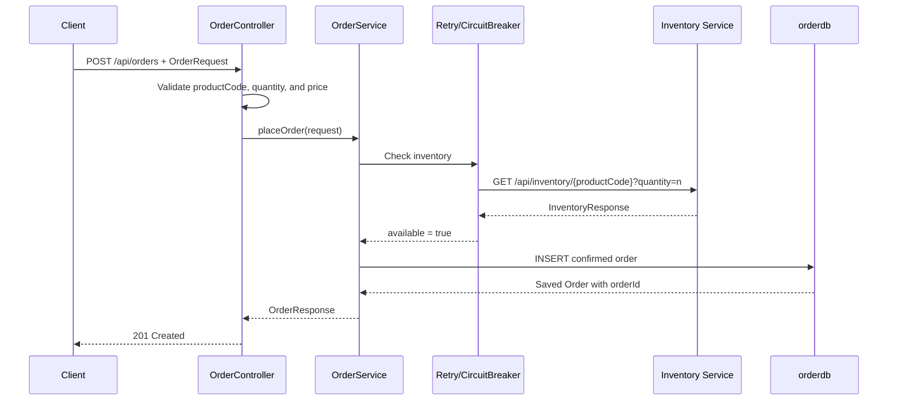
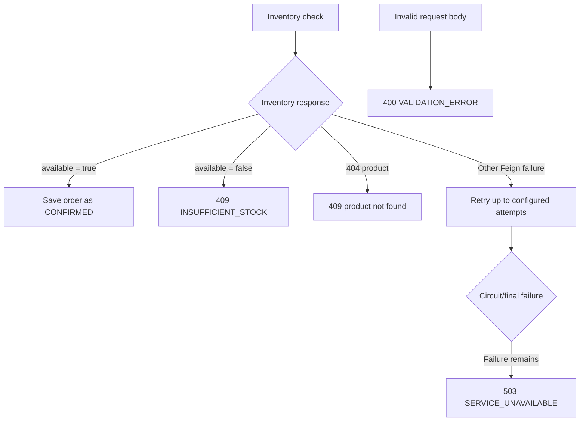

# Order Service

Standalone Spring Boot microservice that validates order requests, checks stock with Inventory Service, and persists confirmed orders in its own PostgreSQL database. It never connects directly to `inventorydb`.

## Architecture



| Component | Responsibility |
| --- | --- |
| `OrderServiceApplication` | Starts Spring Boot and enables OpenFeign clients. |
| `OrderController` | Accepts `POST /api/orders`, validates the request body, and returns `201 Created`. |
| `OrderService` | Coordinates inventory validation, stock checks, order creation, and response mapping. |
| `InventoryClient` | Calls Inventory Service at `inventory.service.url`. |
| Resilience4j | Retries configured inventory-service failures and opens a circuit after repeated failures. |
| `OrderRepository` | Persists confirmed `Order` entities in the local `orderdb` database. |
| `GlobalExceptionHandler` | Converts validation, stock, and downstream-service failures into structured HTTP errors. |

The order service owns only the `orders` table. Inventory remains owned by Inventory Service; the order service reads availability through HTTP and does not reserve or decrement stock.

## Execution flow

### Application startup



Hibernate uses `spring.jpa.hibernate.ddl-auto=update`, so the `orders` table is created or updated when the service starts. This project has no `data.sql` seed script.

### Place-order request



An order is saved only after Inventory Service reports `available: true`. If stock is insufficient, the service throws `InsufficientStockException` and does not write to `orderdb`.

### Failure branches



Inventory `404` responses are translated to a stock conflict for the order API. Other Feign failures become `503 SERVICE_UNAVAILABLE`; Resilience4j may retry the configured failures first, and the circuit breaker fallback returns the same service-unavailable result when the protected call cannot complete.

## Run locally

Prerequisites: Java 17, Maven, PostgreSQL, and a running Inventory Service.

1. Start Inventory Service on port `8082`.

2. Create the order database if it does not already exist:

   ```sql
   CREATE DATABASE orderdb;
   ```

3. Ensure PostgreSQL is running and the configured credentials can connect. The current local configuration is:

   - URL: `jdbc:postgresql://localhost:5432/orderdb`
   - User: `postgres`
   - Password: `root`

   For shared or production environments, override these values with environment/profile-specific configuration rather than committing credentials.

4. Start the order service from this directory:

   ```text
   mvn spring-boot:run
   ```

The order service listens on `http://localhost:8081` and calls `http://localhost:8082` for stock checks.

## API

### Place an order

```http
POST http://localhost:8081/api/orders
Content-Type: application/json

{
  "productCode": "P1004",
  "quantity": 2,
  "price": 75000
}
```

Successful response (`201 Created`):

```json
{
  "orderId": 1,
  "productCode": "P1004",
  "quantity": 2,
  "price": 75000,
  "status": "CONFIRMED",
  "createdAt": "2026-10-28T12:00:00"
}
```

The request fields are required and must be positive: `productCode` cannot be blank, and `quantity` and `price` must be greater than zero.

## Error responses

Errors use this response shape:

```json
{
  "timestamp": "2026-10-28T12:00:00.000",
  "status": 409,
  "error": "INSUFFICIENT_STOCK",
  "message": "Insufficient stock for product: P1004",
  "path": "/api/orders"
}
```

| Condition | Status | Error code |
| --- | ---: | --- |
| Invalid request body | `400` | `VALIDATION_ERROR` |
| Product missing or insufficient stock | `409` | `INSUFFICIENT_STOCK` |
| Inventory Service unavailable | `503` | `SERVICE_UNAVAILABLE` |

## Build and verify

```text
mvn clean verify
```

The main source is under `src/main/java` and configuration is in `src/main/resources/application.properties`.
